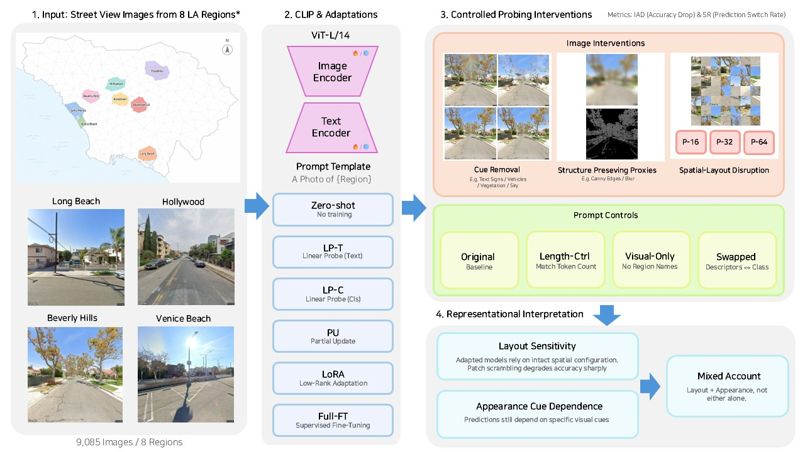
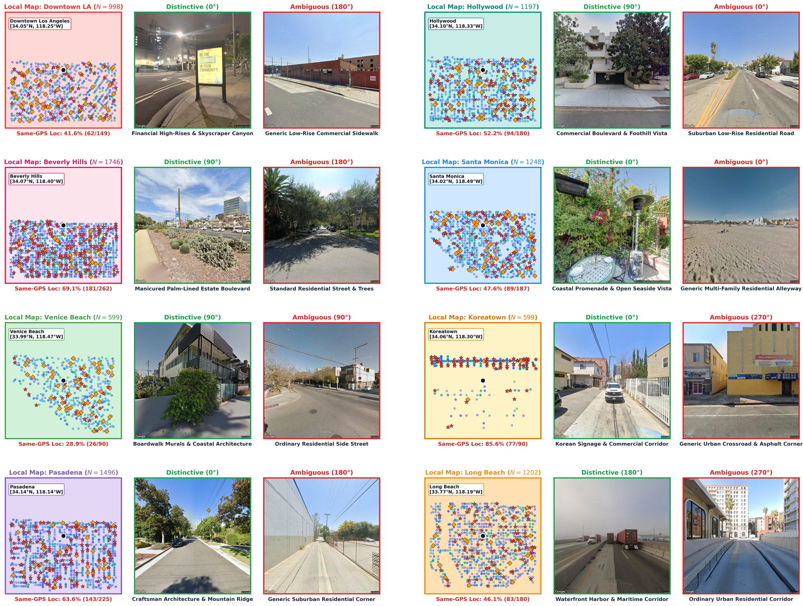
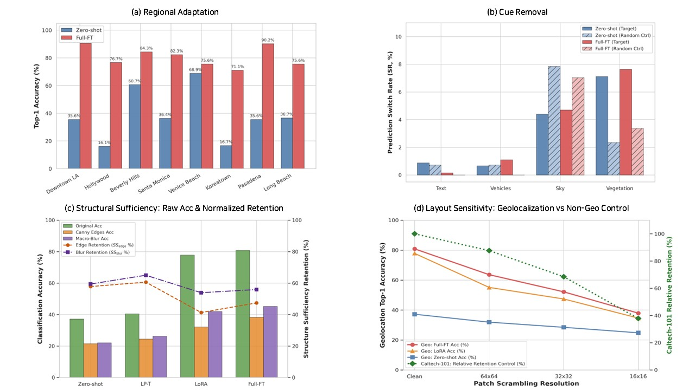
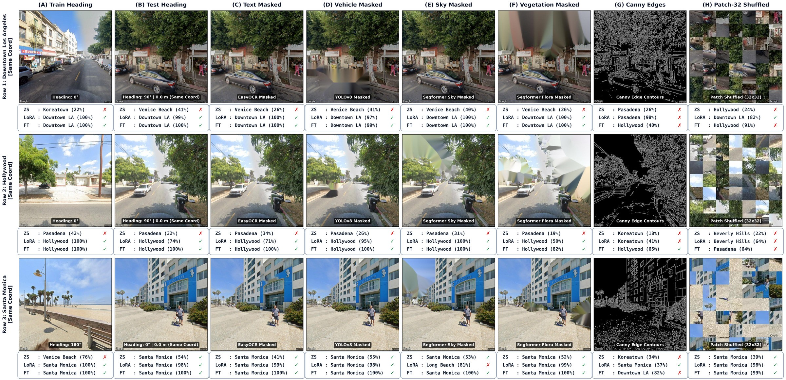

<div align="center">

# What Does CLIP Learn for Regional Geolocalization?<br><sub>Probing Visual Cues and Scene Configuration After Adaptation</sub>

**[Changyu Lee](https://github.com/cksrblee)<sup>1</sup> &nbsp;&middot;&nbsp; Yeonsoo Park<sup>1</sup> &nbsp;&middot;&nbsp; Abdullah Alfarrarjeh<sup>2</sup> &nbsp;&middot;&nbsp; Seon Ho Kim<sup>1,&ast;</sup>**

<sup>1</sup>University of Southern California &nbsp;&nbsp;|&nbsp;&nbsp; <sup>2</sup>German Jordanian University

<br>

[](https://arxiv.org/abs/2608.21761)
[](#citation)
[](LICENSE)

<br>

[**Paper**](https://arxiv.org/abs/2608.21761) &nbsp;&bull;&nbsp;
[**Project Page & Interactive Demo**](https://cksrblee.github.io/clip-geolocation/#livedemo) &nbsp;&bull;&nbsp;
[**Dataset Spec**](docs/DATASET.md) &nbsp;&bull;&nbsp;
[**Probing Protocol**](docs/PROBING_GUIDE.md) &nbsp;&bull;&nbsp;
[**BibTeX**](#citation)

</div>

---

<p align="center">
  
</p>
<p align="center">
  <sub><b>Figure 1.</b> Overview of regional geolocalization across eight Greater Los Angeles regions with OpenCLIP <code>ViT-L-14</code> adaptation strategies, three families of controlled visual interventions, and zero-shot prompt controls.</sub>
</p>

## Highlights

> [!NOTE]
> **Core Question:** *When CLIP is adapted for fine-grained intra-metropolitan geolocalization, does it learn genuine scene configuration or rely on surface appearance cues?*

- **Frozen Readouts vs. Encoder Adaptation:** On **9,085** area-normalized Google Street View images across **8 Greater Los Angeles regions**, frozen readouts (`LP-T`, `LP-C`) remain near the **39.03%** zero-shot baseline, whereas encoder adaptation (`PU`, `LoRA`, `Full-FT`) reaches **75.94–82.10%** accuracy and reduces centroid error from **12.30 km to 3.86 km**.
- **Cue-Removal Sensitivity (Bundle A):** Environmental cues (**vegetation** $F=35.04$, **sky** $F=10.93$; one-way ANOVA $p < 0.01$) induce substantially larger accuracy drops than storefront **text** or **vehicles** (`LoRA` SR: `7.92%` vegetation, `5.65%` sky vs. `1.83%` text, `1.91%` vehicles).
- **Appearance Reduction vs. Layout Disruption (Bundles B & C):** Adapted models achieve higher raw accuracy on Canny edges (`38.3%`) and macro-blur (`45.2%`) without increasing normalized retention (`SS`), while exhibiting sharply higher sensitivity to $16\times16$ patch scrambling (`42.92–45.56%` vs. `10.79–14.60%` for frozen readouts) alongside a 2,000-image **Caltech-101** control.

<details>
<summary><b>📊 Click to expand Paper Figures (Dataset Map, Quantitative Probing & Qualitative Cases)</b></summary>
<br>

### Figure 2: Eight Greater Los Angeles Regions ($N = 9,085$)
<p align="center">
  
</p>

### Figure 3: Four-Panel Quantitative Probing Summary
<p align="center">
  
</p>

### Figure 4: Qualitative Viewpoint & Intervention Cases
<p align="center">
  
</p>

</details>

---

## Main Results (`ViT-L-14`)

| Adaptation Setting | Trainable Scope | Test Acc. (%) | Centroid Error (km) | Patch-16 SR (%) | Patch-32 SR (%) | Patch-64 SR (%) |
| :--- | :--- | :---: | :---: | :---: | :---: | :---: |
| **Zero-shot** | Frozen backbone | 39.03 | 12.30 | 12.40 | 8.73 | 5.28 |
| **LP-T** | Text-score scale & bias | 41.45 | 12.25 | 14.60 | 9.24 | 6.46 |
| **LP-C** | Linear classifier head | 38.52 | 11.22 | 10.79 | 7.92 | 4.92 |
| **PU** | Final ViT block + `ln_post` | 75.94 | 5.08 | 45.56 | 41.31 | 36.10 |
| **LoRA** ($r=8$) | Attention & MLP PEFT adapters | 78.36 | 4.21 | 43.21 | 30.45 | 22.74 |
| **Full-FT** | Full visual encoder | **82.10** | **3.86** | 42.92 | 28.69 | 17.24 |
| *Prompt Ctrl: Length* | Zero-shot + neutral filler | 38.30 | — | — | — | — |
| *Prompt Ctrl: Visual-only* | Region-name-free descriptors | 36.24 | — | — | — | — |
| *Prompt Ctrl: Swapped* | Cyclically reassigned descriptors | 11.15 | — | — | — | — |

<details>
<summary><b>📋 Click to expand Tables II & III (Structure Proxies & Caltech-101 Control)</b></summary>
<br>

**Table II — Appearance-Reduced Structure Proxies**

| Input | Zero-shot Acc. / Retention | LoRA Acc. / Retention | Full-FT Acc. / Retention |
| :--- | :---: | :---: | :---: |
| **Canny Edges** | 21.5% / 0.55 | 32.1% / 0.41 | **38.3%** / 0.47 |
| **Macro Blur ($\sigma=15$)** | 22.1% / 0.57 | 42.0% / 0.54 | **45.2%** / 0.55 |

**Table III — Caltech-101 Zero-Shot Scrambling Control ($N = 2,000$)**

| Condition | Accuracy (%) | Relative Drop (%) |
| :--- | :---: | :---: |
| **Clean** | **89.65** | 0.00 |
| **Patch-16** | 33.90 | 62.19 |
| **Patch-32** | 61.40 | 31.51 |
| **Patch-64** | 78.60 | 12.33 |

</details>

---

## Repository Structure

```text
configs/
  la_county_regions.json          Region bounding boxes and metadata
  prompt_controls.json            Region-name-free visual descriptors
dataset/
  metadata.csv                    Raw merged metadata (28,550 images; 28,520 eligible)
  sampled_metadata.csv            Area-normalized sample (9,085 images; 194.49 img/km²)
  {train,val,test}_metadata.csv   Region-stratified 70/15/15 splits (seed 42)
  spatial_overlap_summary.csv     Test-to-train coordinate proximity audit
figures/
  figure1.jpg - figure4.jpg       Publication figures (Overview, Dataset, Probing, Qualitative)
scripts/
  download_data.py                Optional: download Street View images via Google Maps API
  00_build_splits.py              Area-normalized sampling and 70/15/15 splits (Sec. III)
  01_train_baselines.py           Train & evaluate 6 adaptation strategies (Table I, Fig. 3a)
  01_1_train_lpc.py               Optional force-retrain helper for LP-C tuning
  02_build_interventions.py       Generate 13 probing interventions (Bundles A, B, C)
  03_audit_interventions.py       Audit completeness & image readability
  04_evaluate_bundles.py          Evaluate models across probing conditions (Tables I-II, Fig. 3b-d)
  05_compute_visual_cue_statistics.py  Visual cue coverage & one-way ANOVA (Sec. V-A)
  06_prompt_grounding.py          Evaluate 4 zero-shot prompt controls (Table I)
  07_nongeo_control.py            Caltech-101 non-geographic scrambling control (Table III)
  run_all.sh                      End-to-end experiment pipeline runner
src/
  data/                           Sampling, splits, Street View downloader, datasets
  models/                         LP-T, LP-C, PU, PEFT LoRA, and Full-FT setup
  interventions/                  Masking, edge/blur, and patch-scrambling transforms
  evaluation/                     Inference, metrics, ANOVA, prompt controls
tests/                            Unit tests for splits, metrics, models, and interventions
```

> Raw Street View JPEGs, generated interventions, model checkpoints, and generated `results/` CSVs are gitignored.

---

## Quick Start

### 1. Environment Setup

```bash
conda env create -f environment.yml
conda activate clip-geo
```

Or via `pip`:

```bash
python3 -m pip install -r requirements.txt
```

Place the Street View JPEGs under `dataset/images/` matching the filenames in `dataset/*_metadata.csv` (or see `python3 scripts/download_data.py --help` to collect via your own Google Maps API key).

### 2. Run the Experiment Pipeline

Run all stages end-to-end:

```bash
bash scripts/run_all.sh --model ViT-L-14
```

<details>
<summary><b>🔧 Click to view individual step-by-step commands</b></summary>
<br>

```bash
# 0. Area-normalized sampling & 70/15/15 stratified splits
python3 scripts/00_build_splits.py

# 1. Train & evaluate Zero-shot, LP-T, LP-C, PU, LoRA, Full-FT
python3 scripts/01_train_baselines.py --model ViT-L-14
python3 scripts/01_1_train_lpc.py --model ViT-L-14 --learning-rate 1e-4  # optional LP-C re-run

# 2-3. Generate & audit controlled visual interventions (Bundles A, B, C)
python3 scripts/02_build_interventions.py --bundles A B C
python3 scripts/03_audit_interventions.py

# 4. Evaluate models across clean + 13 intervention conditions
python3 scripts/04_evaluate_bundles.py --model ViT-L-14

# 5-7. Regional cue ANOVA, prompt controls, and Caltech-101 control
python3 scripts/05_compute_visual_cue_statistics.py
python3 scripts/06_prompt_grounding.py --model ViT-L-14
python3 scripts/07_nongeo_control.py --model ViT-L-14 --samples 2000
```

</details>

### 3. Controlled Intervention Matrix

| Bundle | Role | Conditions | Detectors / Transforms |
| :--- | :--- | :--- | :--- |
| **Bundle A** | Cue removal | `text_masked`, `vehicle_masked`, `sky_masked`, `vegetation_masked` | EasyOCR, YOLOv8n, SegFormer-B0 + Telea inpainting |
| **Bundle A (Ctrl)** | Area-matched controls | `random_rectangle`, `sky_random_control`, `vegetation_random_control` | Square random masks + Telea inpainting |
| **Bundle B** | Appearance reduction | `edges`, `macro_blur` | Canny edges (`100/200`), Gaussian blur ($\sigma=15$) |
| **Bundle C** | Layout disruption | `patch_shuffled_16`, `patch_shuffled_32`, `patch_shuffled_64`, `patch_mixed` | Grid permutation & cross-region checkerboard |

### 4. Unit Tests

```bash
python3 -m unittest discover -s tests -v
```

---

## Citation

If you find this benchmark or codebase useful in your research, please cite:

```bibtex
@inproceedings{lee2026what,
  title={What Does CLIP Learn for Regional Geolocalization? Probing Visual Cues and Scene Configuration After Adaptation},
  author={Lee, Changyu and Park, Yeonsoo and Alfarrarjeh, Abdullah and Kim, Seon Ho},
  booktitle={Proceedings of the IEEE International Conference on Big Data (BigData)},
  year={2026},
  note={arXiv:2608.21761}
}
```

## Acknowledgments & License

This research has been supported in part by the USC Integrated Media Systems Center (IMSC). Released under the [MIT License](LICENSE).
